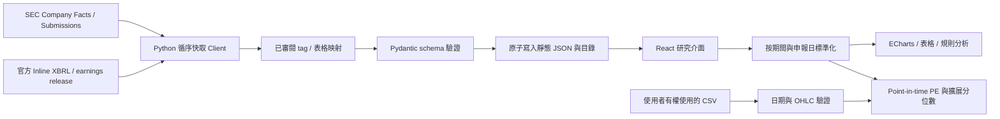

# 架構

沒有後端與資料庫。`public/data/catalog.json` 為股票可用性清單；`SOFI.json` 保存所有原始 filing vintage，不只保存最新值，供重編稽核及歷史估值。數字不靠遠端 JS 服務即時計算。

## 模組

| 位置 | 職責 |
|---|---|
| `scripts/openstock/sec.py` | 官方 HTTPS、24h cache、限速、重試 |
| `mapping.py` | 語意相容概念映射，不合併候選標籤 |
| `inline.py` | 受限的 consolidated Inline XBRL 解析 |
| `supplemental.py` | SoFi 官方公告表格，具體表頭、單位與行標籤驗證 |
| `normalize.py` | 單季還原、最新申報版本、as-of 過濾 |
| `formulas.py`, `valuation.py` | 純函式及明確分割事件調整 |
| `models.py`, `validate.py` | schema、日期、有限數值、catalog identity |
| `pipeline.py` | 白名單、公司口徑、原子輸出與失敗保留 |
| `src/lib/finance.ts` | 前端同規則計算、CSV、歷史估值 |
| `src/components/` | ECharts 共用圖、規則分析 |
| `src/App.tsx` | 靜態目錄、資料載入、研究頁與假設面板 |

Python 與 TypeScript 都有季度 / TTM 測試。跨語言模型目前為手動同步，需維持相同等價標籤表；不是由 schema 自動生成。UI 文案集中於前端元件與 labels，`lang=zh-Hant`；英文翻譯系統尚未實作。

## 發布一致性

先抓取全部需要的來源、驗證輸出，再以同目錄 temporary file + replace 寫入公司資料，最後更新 catalog。這是單檔原子寫入，**不是跨檔交易**；CI 會再次驗證目錄後才將兩檔放進同一 PR。更新命令應單一程序執行；Actions 用 concurrency 限制重疊。

HTML 不使用 `dangerouslySetInnerHTML`；React 會跳脫官方及匯入文字。來源連結限 SEC HTTPS；CSV 表頭、OHLC、重複日期與有限數字檢查，輸出採 CSV quoting 與文字公式開頭防護。這些措施不會取代資料來源或授權核實。
